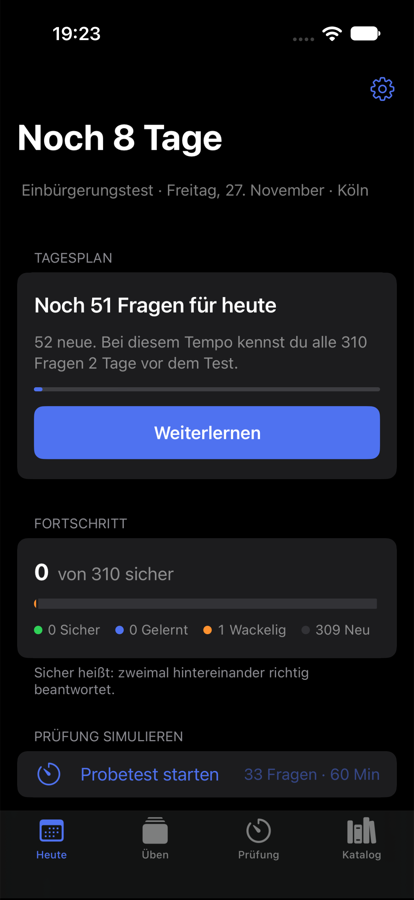
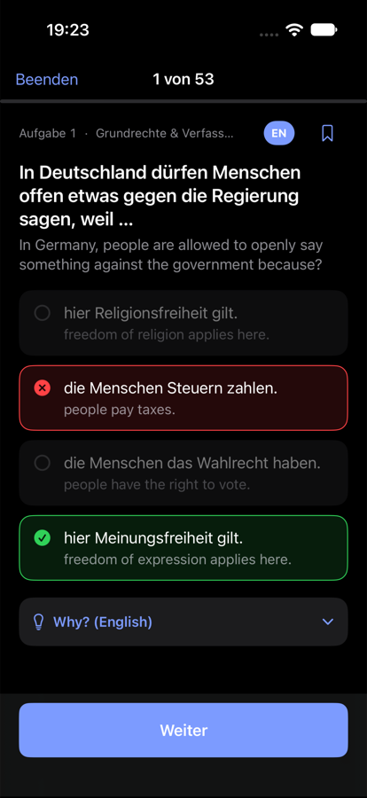
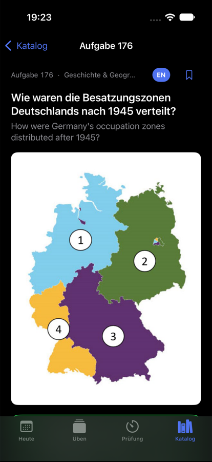
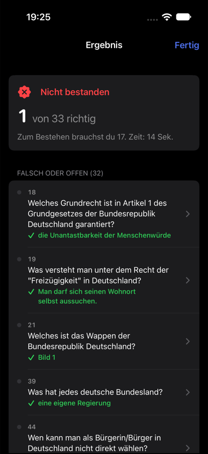

<p align="center">
  
</p>

<h1 align="center">Einbürgerungstest Trainer</h1>

<p align="center">
  A calm, offline iPhone app for learning all questions of the German citizenship test<br>
  (<em>Einbürgerungstest</em> / <em>Leben in Deutschland</em>), built from the official BAMF catalog.
</p>

<p align="center">
  SwiftUI · iOS 17+ · built and installed with <a href="https://github.com/xtool-org/xtool">xtool</a>, no Xcode project
</p>

---

<p align="center">
  
  
  
  
</p>

**Web version:** https://einbuergerungstest-trainer.retromoon.workers.dev (same questions and features, works on any computer or phone browser, keyboard shortcuts on desktop).

## Why

The official catalog is a 191-page PDF with no answers. This app turns it into something you can actually study on your phone in the last days before the test: it says exactly what to learn today, brings back what you got wrong, and lets you sit realistic mock exams.

## Features

| Tab | What it does |
| --- | --- |
| **Heute** | Countdown to your test date and a **daily plan**: spreads all unseen questions evenly so you have seen every one two days before the test, then mixes in due reviews. |
| **Üben** | Practise by topic, in catalog order (blocks of 30), mistakes only, bookmarked, unseen, or 20 random. Instant right/wrong feedback; wrong answers come back at the end of the run. |
| **Prüfung** | Mock exam exactly like the real one: **33 questions** (30 general + 3 state), **60-minute timer**, **pass at 17**. No feedback until you hand in, then a review of every miss. |
| **Katalog** | All questions with the correct answer, searchable by text or number, filterable by topic. |

- **German first, English on tap.** Questions are shown in the official wording. An **EN** button reveals an English translation of the question and every answer, and a *Why?* panel explains the correct answer after you respond.
- **Spaced repetition.** A small Leitner system (intervals 0/1/2/4/7 days). A question counts as *sicher* after two correct answers in a row; a wrong answer resets it.
- **Exam fidelity.** Official numbering, answer order and all picture questions (coats of arms, flags, maps, ballot papers) rendered straight from the BAMF PDF.
- **Private.** No account and no analytics. Progress lives on the device; optional sync between phone and browser uses a random code, not an account.
- Dark mode, Dynamic Type, VoiceOver labels on answer states, Reduce Motion respected.

The bundled catalog contains the **300 general questions + the 10 questions for Nordrhein-Westfalen**. Other states are one line away (see below).

## Build and run

Requirements: macOS with Xcode installed, Python 3, and [xtool](https://github.com/xtool-org/xtool) (`brew install xtool`).

```bash
# Once after cloning: recreate the five press photos from the official BAMF PDF
tools/fetch_photos.sh

# Simulator build
xtool dev build --triple arm64-apple-ios17.0-simulator
xcrun simctl install booted xtool/EinbuergerungTrainer.app

# Your own iPhone (connected via USB, signed with your Apple ID)
xtool auth login        # once
xtool dev run
```

Apps signed with a free Apple ID expire after 7 days; run `xtool dev run` again to refresh (progress is kept).

### Why the photos aren't in the repo

Five picture questions (55, 70, 181, 216, 235) use press photos credited to © Deutscher Bundestag and © Bundesregierung. They are not redistributed here. [`tools/fetch_photos.sh`](tools/fetch_photos.sh) downloads the official catalog from bamf.de and renders exactly those pictures into `Sources/EinbuergerungTrainer/Resources/` (git-ignored). Pass a local PDF path to skip the download. Without them the app still runs and shows a placeholder for those five questions.

## Syncing phone and browser

Progress, bookmarks, mock exams, today's plan and the test date can be kept in sync between the iPhone app and the web version:

1. On one device open **Einstellungen → Synchronisieren → Sync-Code erstellen**.
2. On the other device enter that 20-character code under **Mit Code verbinden**.

After that both sync automatically when opened, a few seconds after you answer, and when you leave the app. There are no accounts: the code is the key, so anyone with it can see your progress (nothing personal is stored).

The sync API is the same Cloudflare Worker that serves the web app ([`web/worker.js`](web/worker.js)), storing state in Workers KV under a SHA-256 hash of the code. The server merges what each device sends, so nothing is overwritten: per question the most recent answer wins, mock exams are combined, today's plan is shared, a test date you set beats a placeholder, and a reset on one device clears both.

## Web version

`web/` is a dependency-free static version of the app (plain HTML, CSS and JavaScript) that shares `catalog.json` and the picture questions with the iOS app. Progress is stored in the browser's `localStorage`, so it stays on that one browser.

- Keyboard: <kbd>1</kbd>–<kbd>4</kbd> answer, <kbd>Enter</kbd> next, <kbd>←</kbd>/<kbd>→</kbd> move through a mock exam, <kbd>E</kbd> English, <kbd>M</kbd> bookmark.
- The five © press photos are never part of the web build: those questions say a photo belongs there and link to the official PDF.

```bash
node web/build.mjs                          # builds web/dist
python3 -m http.server 8765 -d web/dist     # preview locally
cd web && npx wrangler deploy               # deploy to Cloudflare Workers (static assets + sync API)
```

## Regenerating the question catalog

`Sources/EinbuergerungTrainer/Resources/catalog.json` and the `img_*.png` pictures are generated by [`tools/build_catalog.py`](tools/build_catalog.py):

```bash
python3 -m venv .venv && .venv/bin/pip install pymupdf
curl -L -o katalog.pdf "https://www.bamf.de/SharedDocs/Anlagen/DE/Integration/Einbuergerung/gesamtfragenkatalog-lebenindeutschland.pdf?__blob=publicationFile"
curl -L -o question.json "https://raw.githubusercontent.com/bitesinbyte/leben-in-deutschland/HEAD/src/web/data/question.json"
.venv/bin/python tools/build_catalog.py katalog.pdf question.json Sources/EinbuergerungTrainer/Resources
```

How it works:

1. **Questions, answers, numbering and pictures** are parsed from the official PDF by geometry (checkbox positions), not reading order, so multi-line answers and odd layouts land in the right place. Picture areas are rendered at 220 dpi.
2. **The correct answer** is taken from the community dataset and matched to the official options **by answer text** (gender-order-invariant, e.g. *Bundespräsidentin/Bundespräsident* = *Bundespräsident/Bundespräsidentin*), so a different option order can never shift the key. Any weak match is printed for manual review.

For another state, change `KEEP_STATE = "NW"` to its code (`BY`, `BE`, `HH`, …) and update the state name in `Catalog.swift` / `TodayView.swift`.

The answer key in this repo was reviewed by hand for all 310 questions, including every picture question. If anything ever disagrees with the official catalog, the official catalog wins.

## Project layout

```
Sources/EinbuergerungTrainer/
  Model/      Catalog (bundled questions), Store (progress, plan, exams)
  UI/         Today, Practice, Exam, Catalog screens + shared components
  Resources/  catalog.json, picture questions (press photos generated locally)
web/          static web version (src/, build.mjs) and sync API (worker.js, wrangler.jsonc)
tools/        build_catalog.py, fetch_photos.sh
Assets/       logo.svg, AppIcon.png, screenshots
PRODUCT.md    product context · DESIGN.md design decisions
```

## Design

Native iOS structure with one accent: **Königsblau**, the school fountain-pen ink. The icon is a nib finishing a gold tick. Answer feedback is the one authored motion moment (180 ms ease-out fill plus haptic); everything else uses system transitions. See [DESIGN.md](DESIGN.md).

## Sources and licence

- Questions, answers and pictures: *Gesamtfragenkatalog zum Test „Leben in Deutschland“ und zum „Einbürgerungstest“*, © Bundesamt für Migration und Flüchtlinge (BAMF), Stand 07.05.2025. Press photos (© Deutscher Bundestag, © Bundesregierung) are not included in this repository; they are rendered locally from the official PDF and their credits are shown under each picture in the app.
- Answer key, English translations and explanations: [bitesinbyte/leben-in-deutschland](https://github.com/bitesinbyte/leben-in-deutschland) (MIT).
- App source code: MIT, see [LICENSE](LICENSE). The licence covers the code only, not the BAMF catalog content or its pictures.

This is an unofficial study aid and is not affiliated with or endorsed by BAMF.
